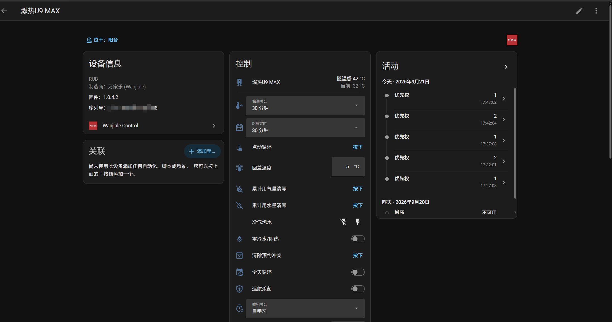
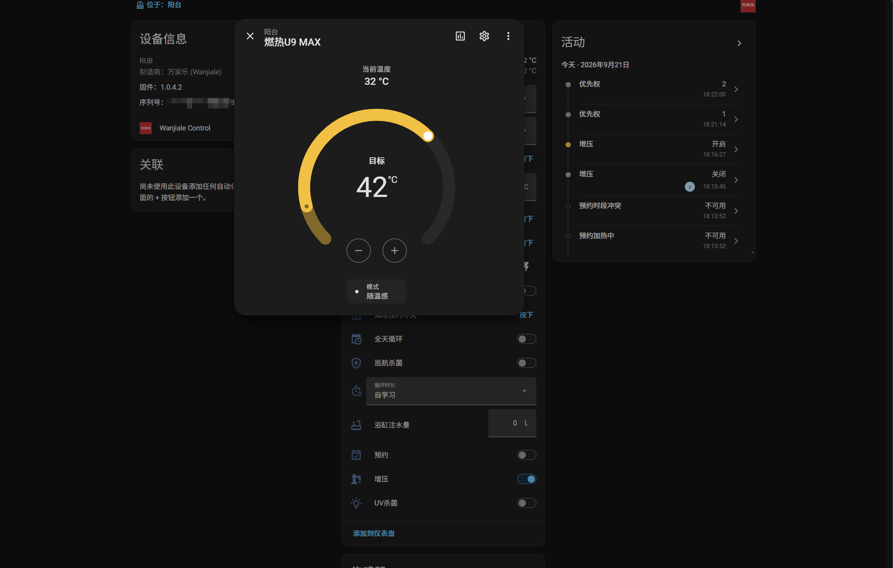
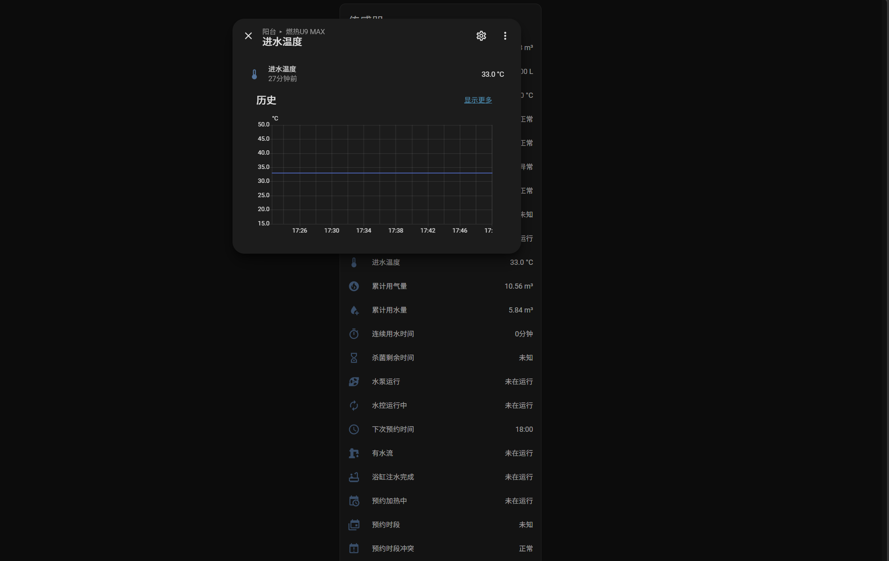

[](https://github.com/hacs/integration)
[](https://github.com/april00x/Wanjiale_Control/releases/latest)
[](https://github.com/april00x/Wanjiale_Control/stargazers)
[](https://github.com/april00x/Wanjiale_Control/issues)

# Wanjiale Control

把万家乐智能热水器 / 壁挂炉接入 Home Assistant。

- 局域网 + 官方云平台连接，控制与状态查询都优先走局域网，失败回退云端
- 开关机、设定温度、模式切换、零冷水、增压、杀菌、预约等控制
- 用水用气统计与故障代码提示







***❗注意：本集成依赖 `pycryptodome` 与 `requests`，登录名就是账号手机号，IMEI 可以留空***

***❗注意：该项目仍在测试阶段，代码和功能可能会有较大的变化***

⭐如果本集成对你有所帮助，请不吝为它点个星，这将是对我的极大激励。

## 支持范围

| 品类 | 状态 | 实体文档 |
| --- | --- | --- |
| 燃气热水器 | 已支持，U9 MAX 实测 | [water_heater.md](doc/water_heater.md) |
| 电热水器 | 已支持 | [electric_water_heater.md](doc/electric_water_heater.md) |
| 燃气壁挂炉 | 已接入（共计46 个机型，暂未测试） | [gas_boiler.md](doc/gas_boiler.md) |
| 油烟机 / 灶具 / 消毒柜等 | TODO |  |

每个品类创建实体、名称和取值含义详见实体文档。壁挂炉一台设备会拆成「卫浴」与「供暖」两个实体。

## 安装

#### 方式一：[HACS](https://hacs.xyz)（推荐）

> HACS > 右上角菜单 > 自定义存储库 > 地址填 `https://github.com/april00x/Wanjiale_Control` > 类别选「集成」 > 搜索 `Wanjiale Control` > 下载

#### 方式二：手动

> 将 `custom_components/wanjiale_control` 整个目录复制到你的 `config/custom_components/`

完成后重启 Home Assistant。

## 配置

添加集成时填官方 App 的账号（手机号）和密码。

集成卡片 > 配置，可进入选项页：

| 选项 | 说明 |
| --- | --- |
| 多端操作权抢占 | 默认关闭。开启后每次控制前会先用登录手机号抢占设备操作权，对应官方 App 的多端互斥机制。机型不校验这一项则无需开启 |
| 强制开启的功能 | 未探测到也创建实体 |
| 强制关闭的功能 | 机型模板声明支持也不创建，用于去掉误判或不需要的功能 |

## 说明

- 实体按机型能力表+设备实际上报创建，没探测到的功能不会出现实体；拿不准的可以在选项页强制开关
- 状态刷新间隔 10 秒；控制下发后先按预期值更新界面，2 秒内忽略设备回写，避免状态回跳
- 局域网连续失败会退避 5 分钟再试，期间走云端，两者互不影响
- 设备地址通过局域网广播自动发现，不需要手动设置固定 IP
- HA 下发控制指令大约有 4 秒延迟，官方 App 侧的变更同步到 HA 也差不多

## 注意事项

***❗注意：「累计用水量清零」与「累计用气量清零」是一次性动作，点下去立即下发，无法撤销。Home Assistant 的按钮实体不支持弹出确认框，操作前请确认***

***❗注意：「点动循环」是水控使能开关，不是一次性动作。打开后只要有水流就会自动触发一次即热，可在开关上随时关闭。旧版本中它是只能开、不能关的按钮，升级后遗留的旧按钮实体可在实体列表中删除***

## 调试

要打开调试日志输出，在 configuration.yaml 中做如下配置

```yaml
logger:
  default: warn
  logs:
    custom_components.wanjiale_control: debug
```

集成详情页还提供「下载诊断信息」，可导出一份 JSON 快照，账号与设备标识已脱敏。

## 常见问题

- **实体比预期少？** 集成按机型能力创建实体，如有缺漏的请反馈。
- **一用水就自动启动即热？** 检查「点动循环」开关是否被打开，关掉即可。
- **没有「冷气泡水」开关？** 该功能只在官方 App 确有气泡水入口的机型上创建，确需使用可在选项页强制开启。
- **预约时段只能看不能改？** HA 没有原生的时间窗实体，改预约又要成对写起止时间，多端同时写容易冲突，所以只读，要改请用官方 App。
- **设备显示离线？** 云端状态推送有延迟时不会立刻判定离线，会参考最近一次成功交互的时间（官方的APP也不稳定）。

## 已知限制

- 只在燃热 U9 MAX 上完整测过，其他机型部分功能未在真机验证
- CO 状态、堵塞条件只有数值范围没有取值枚举，只显示原始值，不做告警判断，避免误报
- 水压、气压、电压、风压、水阀只有少数机型会上报，跨机型含义不一致，暂时未能解析
- 燃气壁挂炉（002）尚未在真机验证，未定案的协议歧义点见 [gas_boiler.md](doc/gas_boiler.md#未验证项) 的未验证项清单

## 支持我的工作

觉得有用的话，点个 Star 就是对项目最大的支持。

也欢迎反馈你手上的机型（品牌型号 + App 里有的功能），帮助补全机型能力表和故障文案。

## 声明

本项目为非官方集成，与万家乐官方无任何关联，仅供学习与家庭自用。接口可能随官方调整而失效，使用本集成产生的后果由使用者自行承担。
